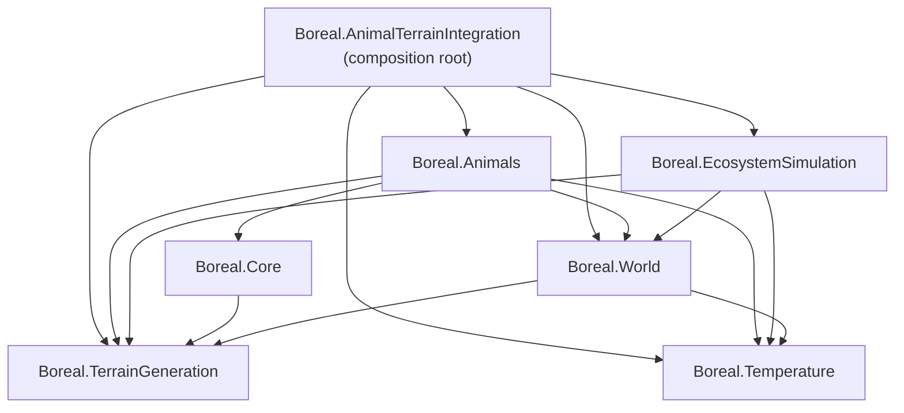

# Architecture

The simulator's code is split into seven runtime assemblies in four layers. Each layer may use only the layers
below it. Each module's editor tools and tests are separate assemblies that never ship in a build. Every namespace
matches its assembly name.

| Layer | Assembly | Folder | Responsibility |
|---|---|---|---|
| 3 | `Boreal.AnimalTerrainIntegration` | `Assets/AnimalTerrainIntegration/Scripts` | Composition root: sets up the scene, and moves animals between the live and off-screen simulations |
| 2 | `Boreal.Animals` | `Assets/Animals` (outside `Temperature`, `Tests`) | Individual animals: genome, body plan, perks, decisions, food, sea biomes, HUD |
| 2 | `Boreal.EcosystemSimulation` | `Assets/EcosystemSimulation/Scripts` | Grid-based population model and habitat analysis |
| 1 | `Boreal.World` | `Assets/World/Scripts` | The terrain as animals see it (walkability, environment samples, temperature, wildlife layer), plus contracts shared by both simulations |
| 1 | `Boreal.Core` | `Assets/_Max/Scripts/Core`, `Assets/Script` (asmref) | Camera, world seed, shared UI kit |
| 0 | `Boreal.TerrainGeneration` | `Assets/TerrainGeneration/Scripts` | Procedural island: heights, erosion, rivers, biomes, vegetation, grass, sea, sky, seasons |
| 0 | `Boreal.Temperature` | `Assets/Animals/Temperature` | Temperature model: providers, zones, the temperature system |

Each module also has `Boreal.<Module>.Editor` (from its `Editor` folder) and `Boreal.<Module>.Tests` (from
`Tests/Editor`) assemblies wherever it has editor tools or tests.

## Rules

The compiler enforces all of these. Code that breaks one does not compile.

1. **References point down.** Unity refuses to compile a reference cycle. A module that needs something from a
   higher layer gets it through an interface it owns (below).
2. **Every reference is declared.** No assembly is auto-referenced, so a module can only see the modules listed in
   its `.asmdef`.
3. **Runtime code builds without the editor.** Editor tools live in `.Editor` assemblies built for the Editor
   platform only. Runtime code touches `UnityEditor` only inside `#if UNITY_EDITOR` (gizmo labels, live inspector updates), so
   a player build compiles without it.
4. **Tests never ship.** `.Tests` assemblies are editor-only and compile only when `UNITY_INCLUDE_TESTS` is defined.
5. **Namespace = assembly.** Each `.asmdef` sets `rootNamespace`, so new scripts created in Unity or an IDE start in
   the right namespace.

## Contracts between modules

The lower module owns each interface, and the higher module implements it (dependency inversion). Each module
therefore knows only the abstraction, never the module above it.

| Interface | Owned by | Implemented by | Used for |
|---|---|---|---|
| `TemperatureProvider` | Temperature | `ProceduralTerrainTemperatureProvider` (World) | The temperature system reads the terrain's temperature, while Temperature itself knows nothing about terrain |
| `IEcosystemMaterializationLifecycle` | World | `SeekFood` (Animals) | EcosystemSimulation folds a live animal back into its population without knowing Animals |
| `IOffscreenPopulation` | Animals | `OffscreenPopulationBridge` (Integration) | The species HUD and census count off-screen animals without knowing the off-screen store |

## Adding code

- **A new script** in a module's folder joins that module's assembly. Put it in `namespace Boreal.<Module>`.
- **Using another module:** add `using Boreal.<Module>;`. If the `.asmdef` doesn't list that module yet, add it
  to `references`, but only if the module is in a lower layer. If it would point up, move the shared piece down
  (often into `Boreal.World`) or define an interface the higher module implements.
- **Editor-only code** goes in the module's `Editor` folder. **Tests** go in `Tests/Editor`.
- **A new module** gets its own folder and `.asmdef`, and a row in the table above.
